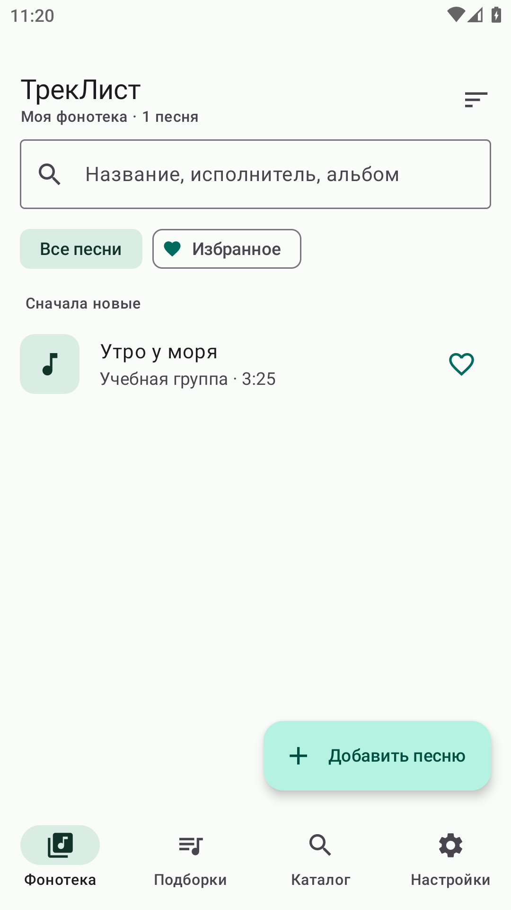
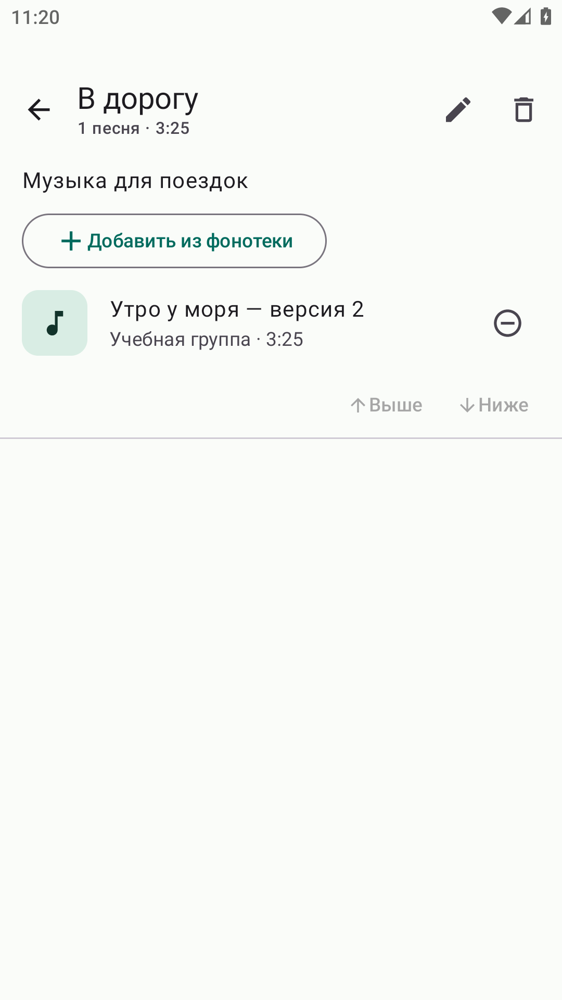
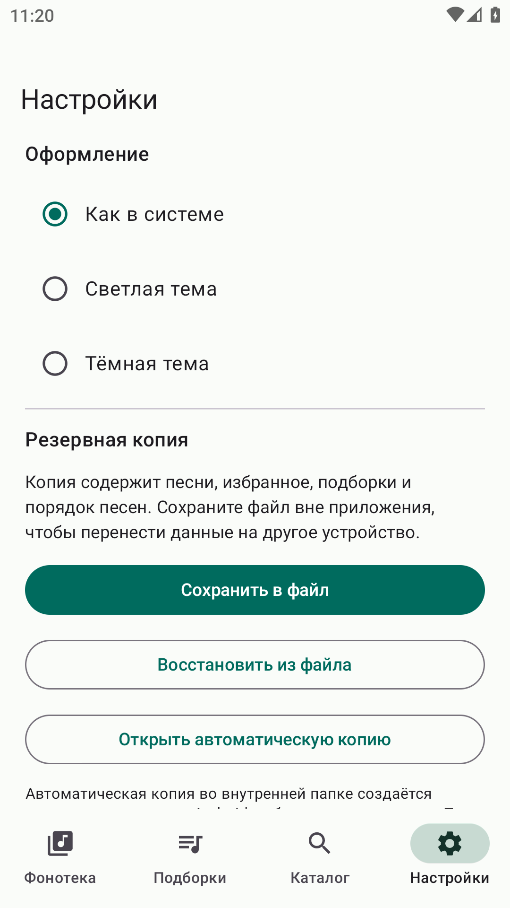

# ТрекЛист

Учебное Android-приложение для управления списком песен. Интерфейс на русском языке. Минимальная версия устройства — Android 8.0 (API 26).

## Возможности

- Ручное добавление, редактирование и удаление песен.
- Поиск по названию, исполнителю и альбому в собственной фонотеке.
- Сортировка по времени добавления, названию или исполнителю.
- Избранное, тематические подборки, изменение порядка песен.
- Поиск через iTunes Search API от Apple и импорт выбранных записей.
- Системная, светлая и тёмная темы.
- Экспорт и восстановление фонотеки в JSON, автоматическая локальная копия.

Приложение хранит сведения о песнях. Воспроизведение аудио в эту версию не входит. iTunes Search API является отдельным сервисом от Apple Music API. Сохранённая фонотека работает без интернета, подключение требуется для внешнего поиска.

## Установка на телефон

1. Скачайте [готовый APK](distribution/TrackList-debug.apk) и перенесите его на Android-телефон.
2. Откройте его и, если Android запросит, разрешите установку для приложения, через которое вы открыли файл.
3. Установите «ТрекЛист» и запустите его.

APK — подписанная учебная отладочная сборка. Для первого знакомства можно открыть «Настройки» и выбрать «Добавить учебные примеры песен». Примеры вымышлены. Новая установка начинает работу с пустой фонотекой.

## Быстрая демонстрация

1. Нажмите «Добавить песню». Укажите название «Утро у моря», исполнителя «Учебная группа» и время `3:25`.
2. Сохраните запись, откройте её и добавьте в избранное.
3. На вкладке «Подборки» создайте подборку «В дорогу».
4. Откройте подборку и добавьте песню из фонотеки. Для нескольких песен используйте «Выше» и «Ниже».
5. Во вкладке «Каталог» введите исполнителя или название и нажмите значок поиска. Кнопка `+` сохраняет найденную запись.
6. В настройках переключите тему, затем сохраните резервную копию в выбранный файл.

Удаление подборки сохраняет песни в общей фонотеке. Удаление песни из фонотеки также удаляет её из всех подборок. Перед этими действиями приложение просит подтверждение.

## Резервные копии

«Сохранить в файл» экспортирует песни, избранное, подборки и порядок песен. «Восстановить из файла» заменяет текущую фонотеку после подтверждения. До замены проверьте, что сохранили нужные текущие данные. Тема оформления в копию не включается.

Файл имеет формат JSON версии 1 и хранится без дополнительного шифрования. Автоматическая внутренняя копия создаётся WorkManager примерно раз в сутки, причём первый запуск может выполняться раньше. Android определяет точное время. Внутренняя копия удаляется вместе с приложением; для переноса на другое устройство используйте экспорт в файл.

## Открытие исходного проекта

1. Установите Android Studio с поддержкой Android Gradle Plugin 8.7.3 или новее.
2. Откройте папку `TrackList`, содержащую `settings.gradle.kts`.
3. Выберите Gradle JDK 17 в настройках проекта.
4. Установите Android SDK Platform 35 и Build Tools 34.0.0 через SDK Manager.
5. Дождитесь загрузки зависимостей. Путь к SDK задаётся Android Studio локально.
6. Выберите эмулятор или подключённое устройство Android 8.0+ и нажмите Run.

SDK, Java и кэши инструментов не включены в исходники. Android Studio загрузит необходимые зависимости. Серверная часть и ключ API не требуются.

## Сборка и проверки

macOS / Linux:

```sh
./gradlew assembleDebug
./gradlew testDebugUnitTest lintDebug
```

Windows:

```bat
gradlew.bat assembleDebug
gradlew.bat testDebugUnitTest lintDebug
```

Готовый APK появляется в `app/build/outputs/apk/debug/app-debug.apk`. Для проверки пользовательского сценария на отдельном тестовом эмуляторе используется `connectedDebugAndroidTest`. Сценарий создаёт тестовые записи и снимки, поэтому запускать его следует на тестовом устройстве с чистыми данными приложения.

В проекте 17 локальных автоматических тестов и один сквозной сценарий интерфейса. Сборка, локальные проверки и сценарий на эмуляторе Android 11 завершились успешно. Подробности приведены в папке `docs`. Проверка на физических устройствах и суточное ожидание фоновой задачи отдельно не выполнялись.

## Структура

```text
app/src/main/java/ru/daniil/tracklist/
  MainActivity.kt              запуск интерфейса
  TrackListApplication.kt      контейнер зависимостей
  BackupWorker.kt              периодическое копирование
  data/                       Room, API, репозиторий, копии, настройки
  domain/TrackRules.kt         проверка полей и форматирование
  ui/MainViewModel.kt          состояние и действия
  ui/TrackListApp.kt           экраны и навигация
app/src/test/                 локальные тесты
app/src/androidTest/          сквозной сценарий интерфейса
app/schemas/                  экспорт схемы Room
```

## Курсовая работа

Файл Word: [Курсовая работа «ТрекЛист»](coursework/Курсовая_ТрекЛист.docx). Титульный лист не добавлен по вашему указанию. После вставки собственного титульного листа обновите оглавление в Word: выделите документ и выполните обновление полей (F9, на некоторых клавиатурах Fn+F9). При запросе выберите обновление всего оглавления. Нумерация страниц и оглавление могут немного измениться из-за установленных шрифтов и версии Word.

## Снимки экранов

| Фонотека | Подборка | Настройки |
| --- | --- | --- |
|  |  |  |
